# NorthStar Medical Group — Identity Lifecycle Management
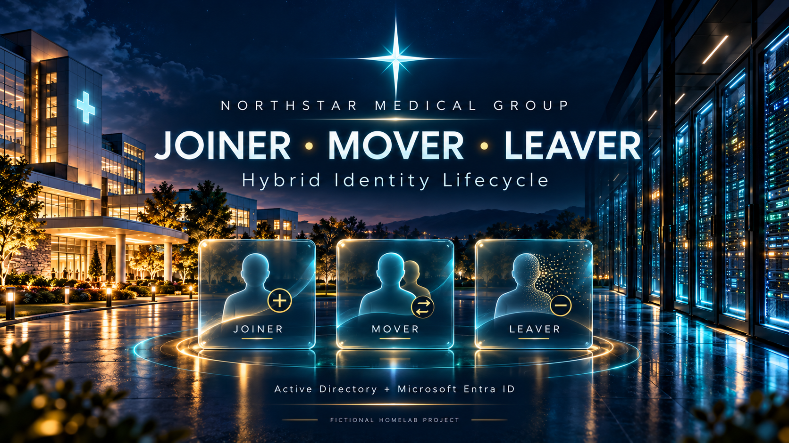

**Joiner • Mover • Leaver | Active Directory • Microsoft Entra ID**

A hands-on home lab exploring how employee access is provisioned,
updated, and removed in a hybrid identity environment.

> NorthStar Medical Group is a fictional organization. All employees,
> business events, approvals, and service requests are simulated.

## Overview

NorthStar Medical Group uses the on-premises Active Directory domain
**NMGM.COM**, synchronized with Microsoft Entra ID through
**Microsoft Entra Connect Sync**.

This project builds on that foundation by introducing three employee
lifecycle scenarios: onboarding a new hire, transferring an employee
between departments, and offboarding a departing employee.

Acting as the IAM administrator, I review simulated requests, perform
approved changes in the lab, and document verification results.

## NorthStar Service Desk

The NorthStar Service Desk is an independent ticketing simulator
used to organize the project’s lifecycle requests.

### [Open the NorthStar Service Desk →](https://northstar-jml-desk-ousmane.royalrook4096.chatgpt.site)

The simulator supports:

- Reviewing and editing lifecycle requests.
- Recording simulated approvals and request statuses.
- Tracking fulfillment checklists.
- Adding work notes and closure details.
- Exporting ticket records for project documentation.

> The simulator does not connect to ServiceNow, Active Directory,
> or Entra ID. Identity changes are performed separately in the lab.
> Ticket progress is saved in the visitor’s browser.
> Access to the hosted simulator depends on its sharing settings.

## Ticket Dashboard

Three requests arrive in the IT service queue: a new hire, a department
transfer, and an employee departure.

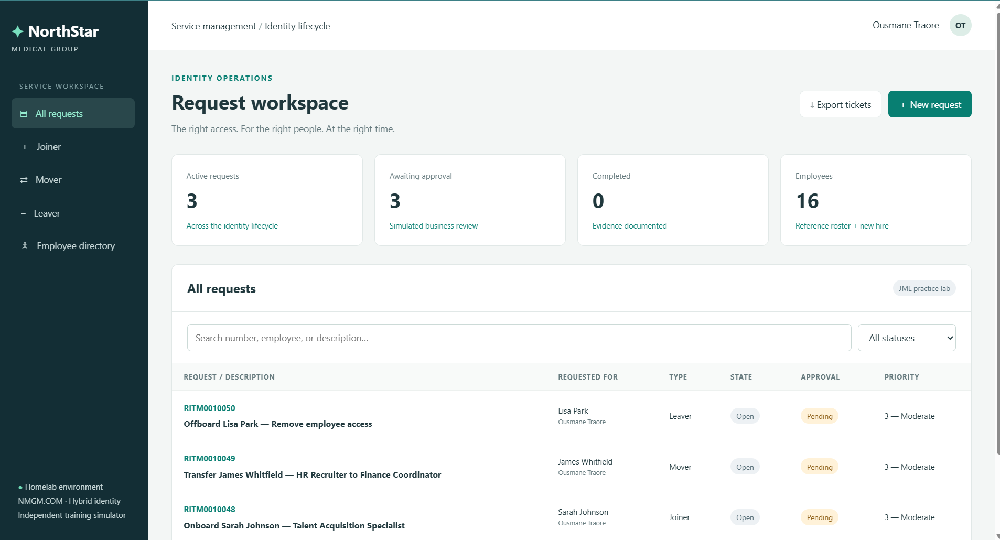


*The simulated service desk tracks Sarah Johnson’s onboarding,
James Whitfield’s transfer to Finance, and Lisa Park’s offboarding.
All three requests are open and awaiting simulated approval.
This dashboard supports tracking request status, documenting work,
and organizing verification evidence throughout the identity lifecycle.
automatically reflect changes made in the simulator.*

## Joiner — Sarah Johnson

### Business Request

Sarah Johnson is joining HR as a **Talent Acquisition Specialist**.
She will coordinate interviews, manage candidate records, and support
hiring managers.

She requires an employee account and approved access to HR and
recruiting resources before her first day.

**Ticket:** RITM0010048  
**Manager:** Sandra Torres — HR Manager

### Planned Actions

- Review the simulated onboarding request and approval.
- Check for an existing account to avoid duplicate identities.
- Create Sarah’s account in the HR OU within NMGM.COM.
- Set her department, job title, and manager.
- Assign HR-Users membership.
- Verify account and membership synchronization to Entra ID.
- Test approved access to configured lab resources.

### Verification Evidence

### Joiner Walkthrough Video

Watch my walkthrough of Sarah Johnson’s onboarding in the
NorthStar Medical Group homelab, covering Active Directory
account creation, Microsoft Entra ID synchronization,
HR-Users membership verification, and ticket documentation.

🎥 [Watch the Joiner walkthrough — Sarah Johnson](https://www.loom.com/share/41d857d728bf4d8db4d54f7d8195cd64)


The following screenshots document Sarah Johnson’s account setup,
Microsoft Entra ID synchronization, and HR-Users membership.

#### 1. Entered Sarah’s Active Directory Account Details

I entered Sarah’s account details in the user creation wizard
within the HR OU of NMGM.COM.

- **Full name:** Sarah Johnson
- **User logon name:** sjohnson@NMGM.com
- **Pre-Windows 2000 logon name:** NMGM\sjohnson
- **Target OU:** HR

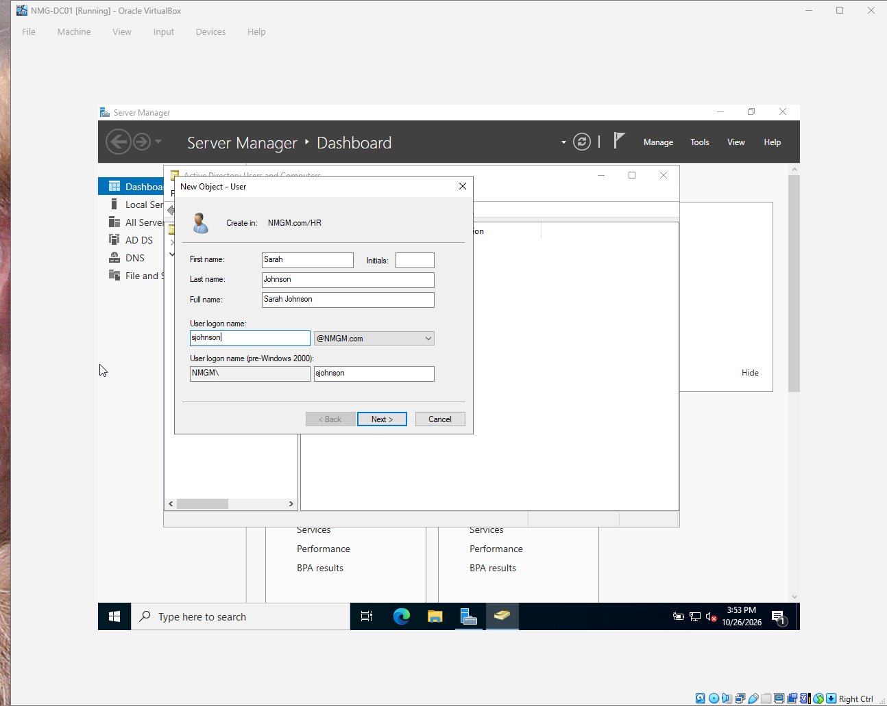

*Evidence: Identity details entered before completing account creation.*

#### 2. Reviewed the Account Creation Settings

I reviewed Sarah’s name, logon name, and target OU.
The account was configured to require a password change
at the next logon.

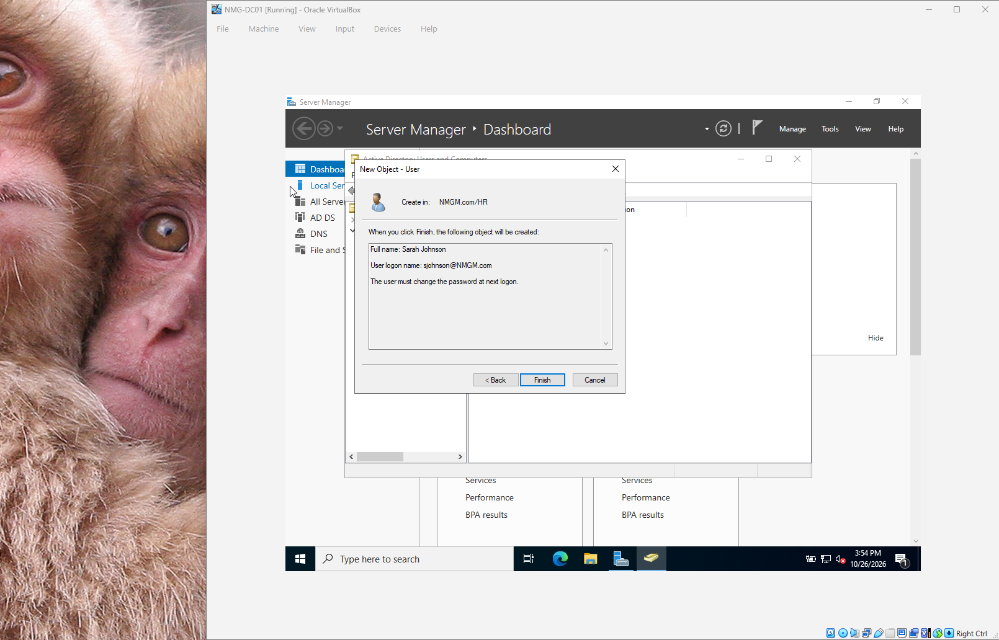
*Evidence: The final review screen before selecting Finish.*

### 3.Troubleshooting — Sarah’s HR-Users Membership

#### Problem

During Sarah Johnson’s onboarding, I created her account in
Active Directory and added her to the **HR-Users** group.
However, her membership was not immediately visible in
Microsoft Entra ID.

I needed to verify that the on-premises changes had synchronized
to the cloud before completing the onboarding documentation.

#### Investigation

I confirmed that Sarah was already a member of **HR-Users**
in Active Directory. I then triggered a delta synchronization
to process recent directory changes.

#### Resolution

On the server running Microsoft Entra Connect Sync, I opened
**Windows PowerShell as Administrator** and ran:

```powershell
Import-Module ADSync
Start-ADSyncSyncCycle -PolicyType Delta
```

The first command loaded the ADSync module. The second requested
a delta synchronization cycle.

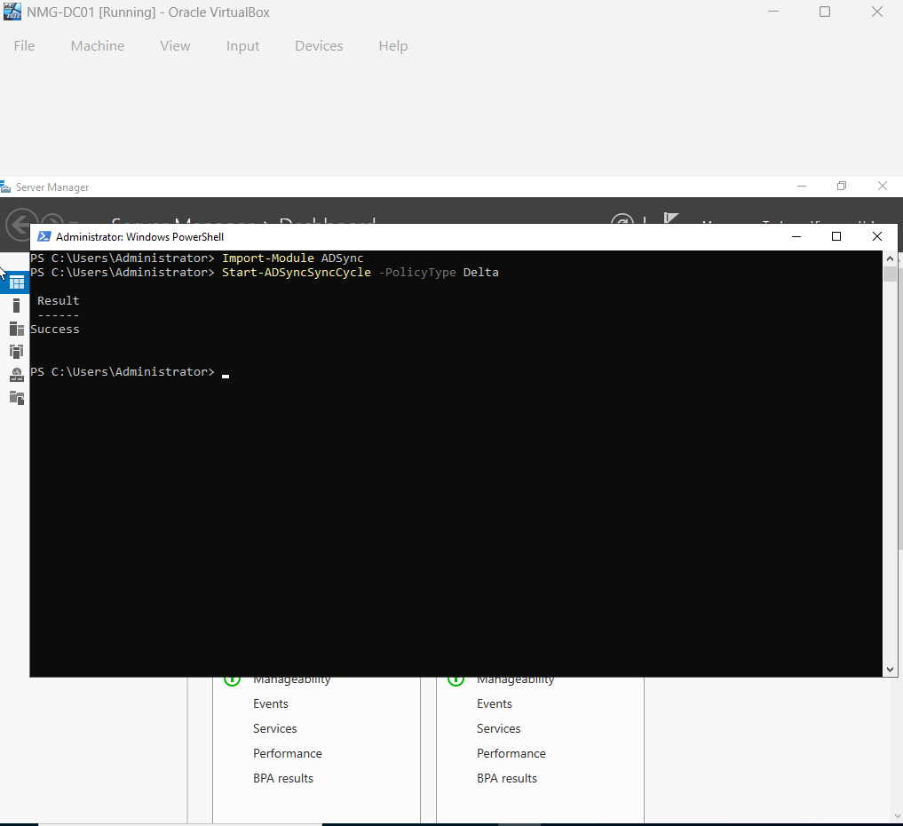

*Evidence: PowerShell returned Success, confirming that the
synchronization request was accepted. This result alone did
not confirm that Sarah’s membership had synchronized.*


#### 4. Checked Sarah’s Account in Microsoft Entra ID

I located Sarah Johnson’s profile in Microsoft Entra ID
and reviewed her identity properties.

Her profile displayed her name and the user type Member.

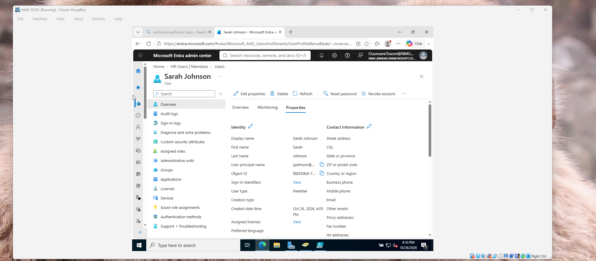
*Evidence: Sarah’s account was present in Microsoft Entra ID.*

#### 5. Verified On-Premises Synchronization

I reviewed Sarah’s account status and synchronization details.

- **Account enabled:** Yes
- **On-premises sync enabled:** Yes
- **Department:** HR
- **On-premises SAM account name:** sjohnson
- **On-premises domain:** NMGM.com


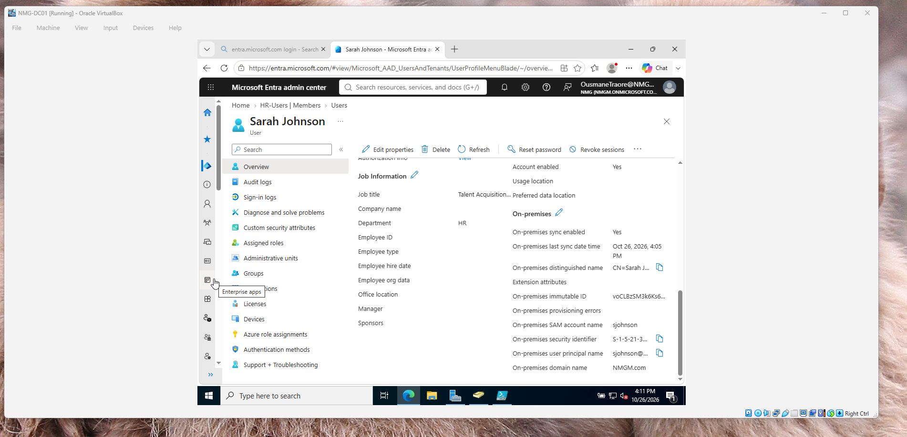
*Evidence: Sarah’s enabled cloud account showed synchronization
from the on-premises directory.*

#### 6. Verified HR-Users Membership in Entra ID

I opened the HR-Users group and confirmed that Sarah Johnson
appeared in its Members list.


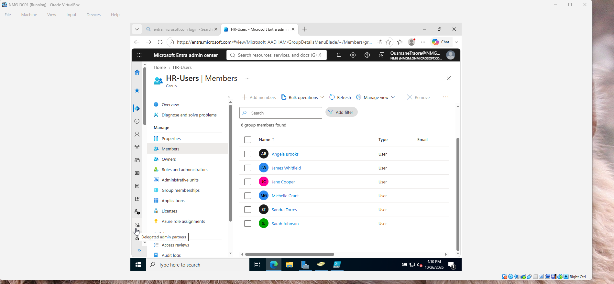
*Evidence: Sarah was listed as a member of HR-Users in Entra ID.*

#### 7. Reviewed the Onboarding Documentation

I documented the onboarding work in ticket RITM0010048,
including the fulfillment checklist, work notes, and closure notes.


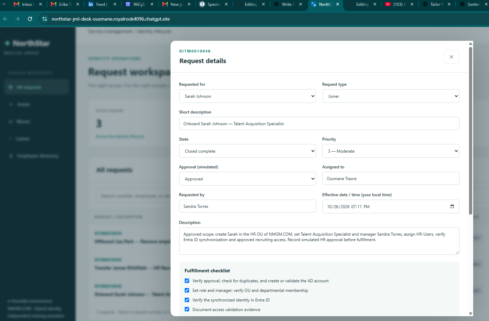
*Evidence: The simulated ticket recorded the onboarding work
and reported verification results.*

#### 8. Confirmed the Ticket’s Final Status

I reviewed the NorthStar Service Desk dashboard and confirmed
that Sarah Johnson’s onboarding request, RITM0010048, was
marked Approved and Closed Complete.

The Mover request for James Whitfield and the Leaver request
for Lisa Park remained open and pending approval.


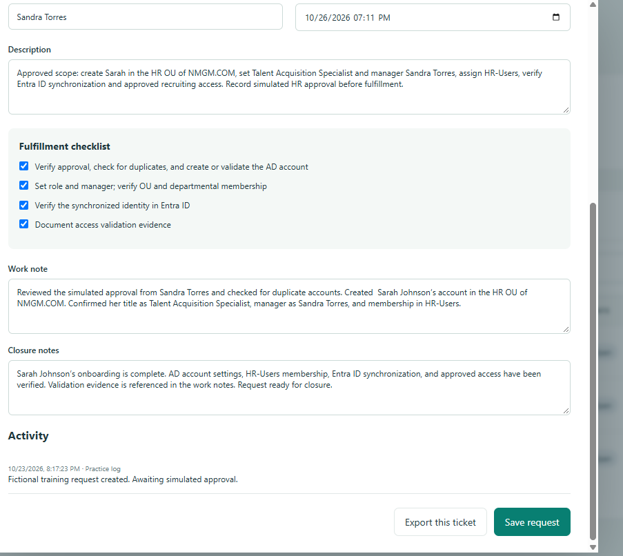

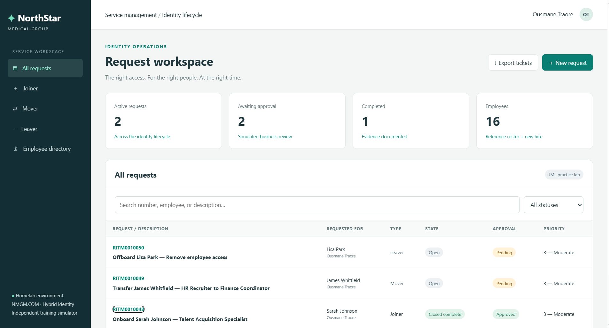
*Evidence: The simulated service desk recorded Sarah’s onboarding
ticket as completed.*


## Mover — James Whitfield

### Business Request

James Whitfield is transferring from **HR Recruiter** to
**Finance Coordinator**, reporting to **David Chen, Finance Manager**.

His new responsibilities include coordinating invoice documentation,
maintaining financial records, and supporting Finance operations.

His access must reflect his new responsibilities. Previous HR access
must be removed unless a specific, time-limited exception is approved.

**Ticket:** RITM0010049  
**Department Change:** HR → Finance  
**Group Change:** HR-Users → Finance-Users


### Planned Actions

- Review the simulated transfer request and manager approvals.
- Record existing account attributes and group memberships.
- Update department to Finance.
- Update job title to Finance Coordinator.
- Update manager to David Chen.
- Move the account from the HR OU to the Finance OU.
- Remove HR-Users membership and add Finance-Users membership.
- Review any other access associated with the previous role.
- Verify synchronized attributes and memberships in Entra ID.
- Test Finance access and removal of previous HR access.

> Moving an account to another OU does not automatically change
> its security group memberships. These changes must be performed
> and verified separately.

### Verification Evidence

### Mover Walkthrough Video

Watch my walkthrough of James Whitfield’s transfer from HR to Finance in the NorthStar Medical Group homelab, covering Active Directory updates, group membership changes, Microsoft Entra ID synchronization, and ticket documentation.


[View the Mover walkthrough](https://www.loom.com/share/546542d3732d4edf88225add532c759b)

The following screenshots document James Whitfield’s department transfer, updated group memberships, and synchronized account information.

#### 1. Verified James’s Account in the Finance OU
I located James Whitfield’s account in the Finance OU within Active Directory Users and Computers.

- **Employee:** James Whitfield
- **Domain:** NMGM.COM
- **Target OU:** Finance

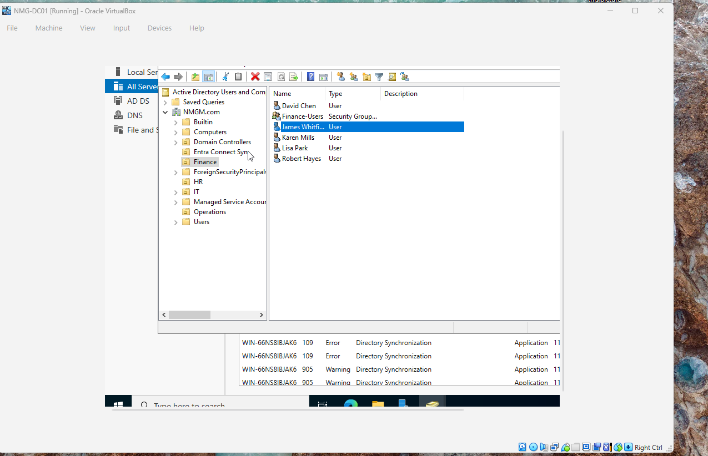


*Evidence: James’s account appeared in the Finance OU following the transfer.*

#### 2. Updated James’s Job Title and Department

I updated James’s account information under **Properties → Organization** to reflect his new responsibilities.

- **Job title:** Finance Coordinator
- **Department:** Finance
- **Required manager:** David Chen

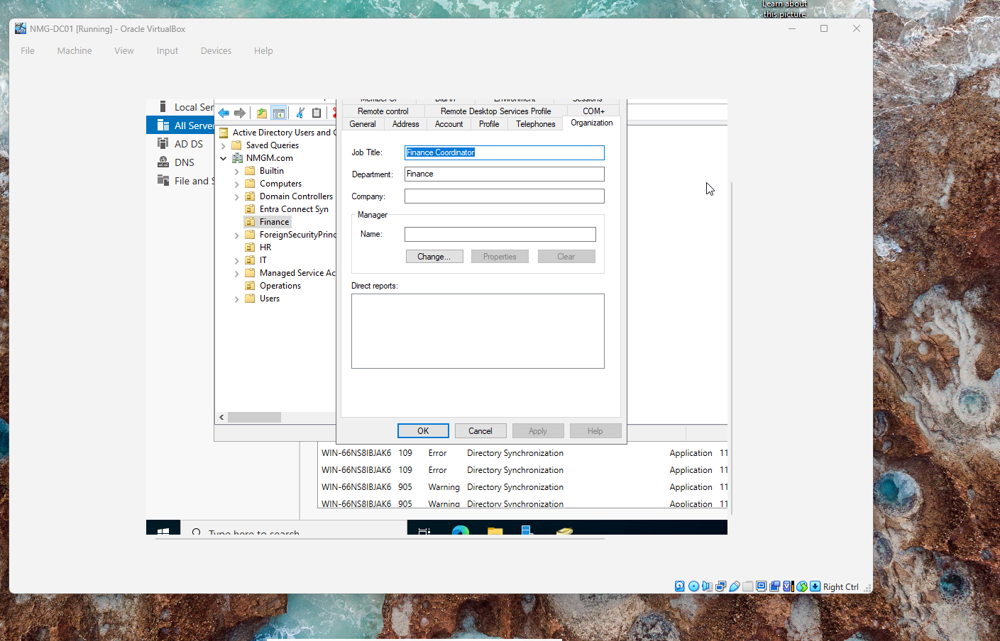

*Evidence: The Organization tab displayed Finance Coordinator and Finance. The Manager field was blank in this capture, so it does not verify the required manager update.*

#### 3. Verified Active Directory Group Memberships

I reviewed James’s **Member Of** tab after updating his departmental group memberships.

**Finance-Users** appeared in the membership list, and **HR-Users** was no longer listed.

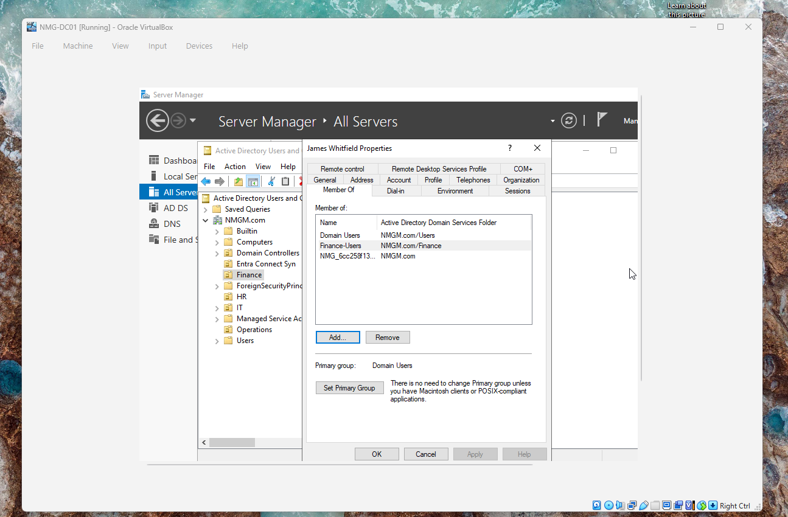

*Evidence: James’s displayed direct memberships included Finance-Users and did not include HR-Users. Other access paths require separate review.*

#### 4. Initiated a Delta Synchronization

I opened PowerShell on the Entra Connect server and ran the following commands:

```powershell
Import-Module ADSync
Start-ADSyncSyncCycle -PolicyType Delta
```

The command returned **Success**.


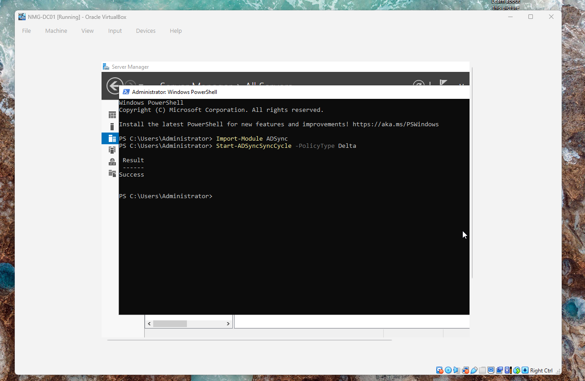

*Evidence: The synchronization request was accepted. The following cloud checks verify the resulting account changes.*

#### 5. Verified Finance-Users Membership in Entra ID

I opened **Finance-Users → Members** in Microsoft Entra ID and confirmed that James Whitfield appeared in the direct members list.

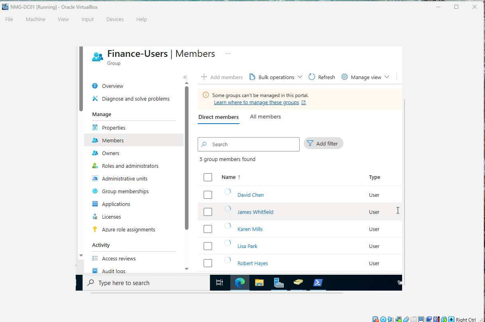

*Evidence: James was listed as a direct member of Finance-Users in Entra ID.*

#### 6. Reviewed James’s Entra ID Profile

I located James Whitfield’s user profile and reviewed his identity information.

- **Display name:** James Whitfield
- **User principal name:** jwhitfield@NMGM.onmicrosoft.com
- **User type:** Member


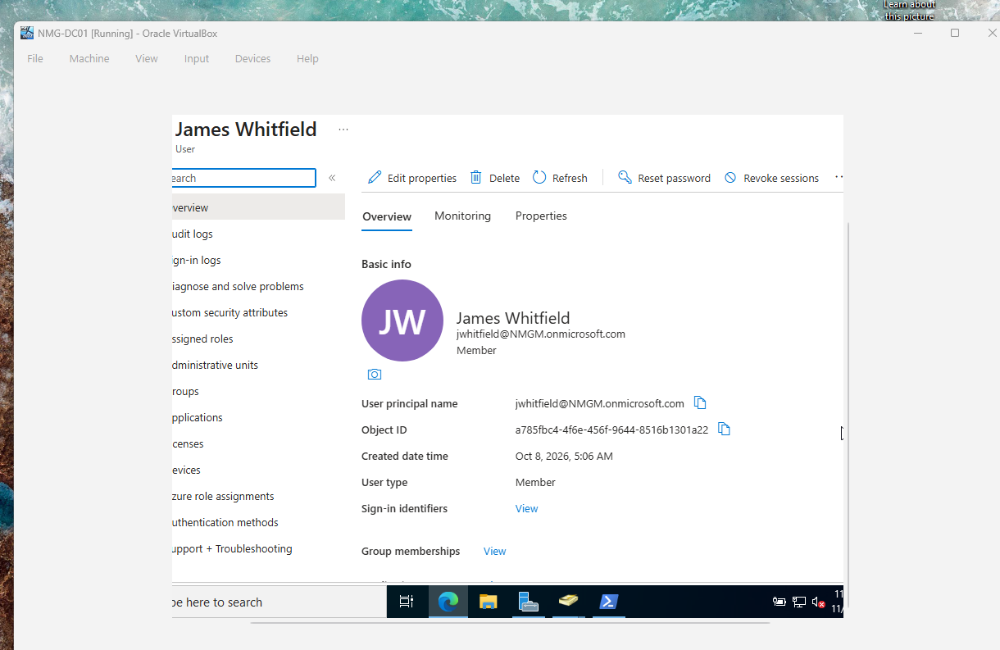

*Evidence: James’s cloud account was present and identified for further verification.*

#### 7. Verified Synchronized Job Information

I reviewed the **Job Information** section of James’s Entra ID profile.

The department displayed **Finance**, and the job title displayed **Finance Coordinat…**, truncated by the portal layout.

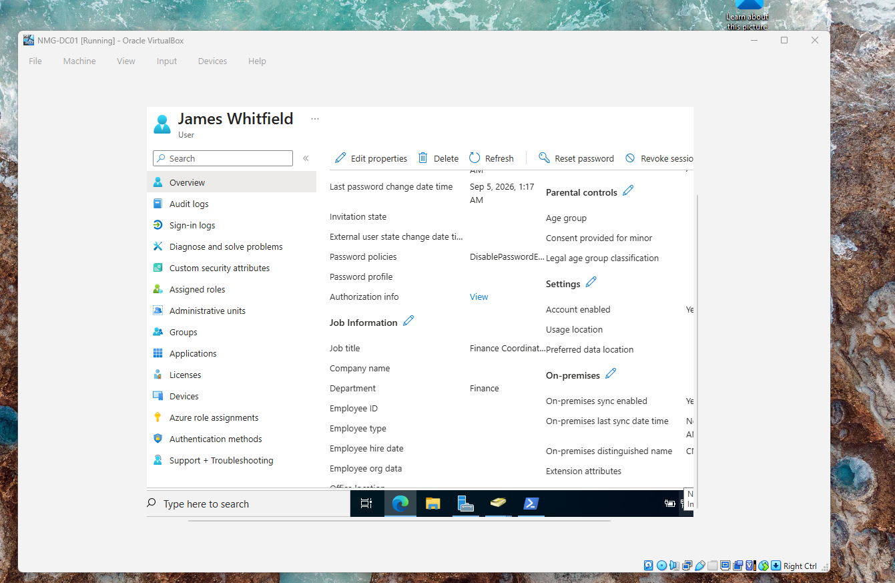

*Evidence: The cloud profile reflected the Finance department and updated job title.*

#### 8. Reviewed the Transfer Ticket Details

I reviewed simulated ticket **RITM0010049**, which documented James’s transfer from HR Recruiter to Finance Coordinator.

- **Requested for:** James Whitfield
- **Request type:** Mover
- **Requested by:** David Chen
- **Assigned to:** Ousmane Traore
- **Displayed state:** Closed complete

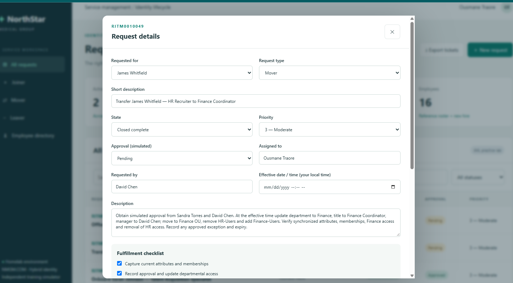

*Evidence: This intermediate capture shows the transfer request and closed state.*

#### 9. Documented the Fulfillment and Closure Notes

I recorded the transfer work in the ticket’s fulfillment checklist, work note, and closure notes.

The documentation covered account attribute changes, the Finance OU move, and replacement of HR-Users membership with Finance-Users membership.

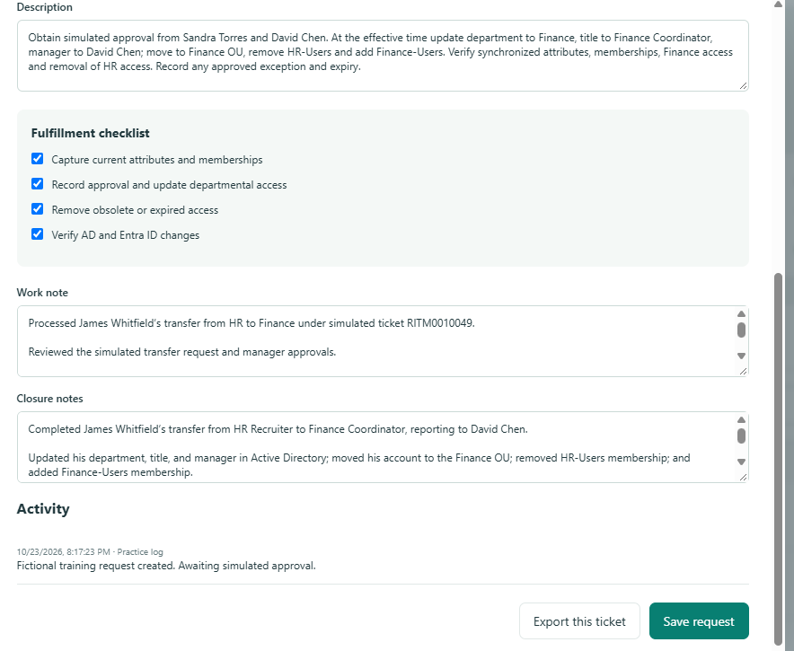

*Evidence: The simulated ticket recorded the implementation work and reported verification results. Technical screenshots provide separate supporting evidence.*

#### 10. Confirmed the Ticket’s Final Dashboard Status

I reviewed the NorthStar Service Desk dashboard and confirmed that James Whitfield’s transfer request, **RITM0010049**, was marked **Approved** and **Closed complete**.

Sarah Johnson’s Joiner request was also completed. Lisa Park’s Leaver request remained open and pending approval at the time of this capture.

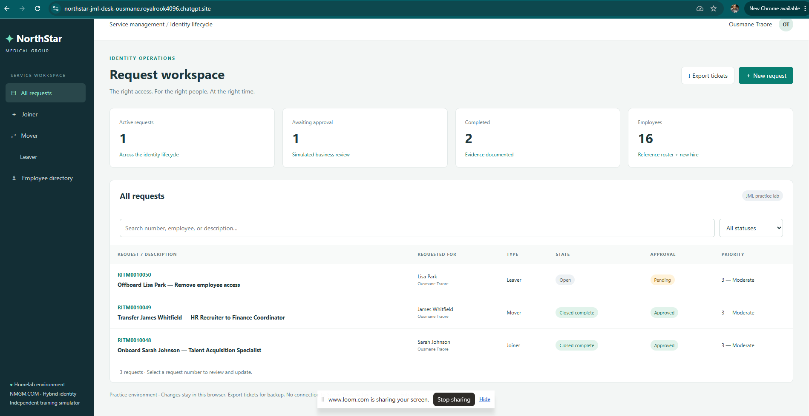

*Evidence: The simulated service desk displayed James’s Mover request as approved and completed.*

### Verification Scope

These screenshots support the Finance OU location, updated job information, AD group changes, synchronization initiation, and Finance-Users membership in Entra ID.

The following checks are not demonstrated by this screenshot set:

- David Chen configured as James’s manager in AD and Entra ID.
- Removal of HR-Users membership verified directly in Entra ID.
- Successful access to an approved Finance resource.
- Denied access to a restricted HR resource.


## Leaver — Lisa Park

### Leaver Walkthrough Video

Watch my walkthrough of Lisa Park’s offboarding in the NorthStar Medical Group homelab, covering Active Directory account disablement, Entra Connect synchronization, and ticket documentation.


### Business Request

In this scenario, Lisa Park is leaving the Operations department.
HR requests that her access end at the approved departure time.

Offboarding requires coordinated access removal across the
on-premises and cloud environments.

**Ticket:** RITM0010050  
**Requested By:** Sandra Torres — HR Manager

### Planned Actions

- Review HR authorization and the effective departure time.
- Verify Lisa’s account, department, and existing access.
- Record any retention or information-transfer requirements.
- Disable her AD account at the approved time.
- Verify the disabled account state in Entra ID after synchronization.
- Revoke cloud sign-in sessions.
- Review and remove remaining group and application access.
- Verify that new sign-ins are blocked.
- Document outstanding application-session limitations or follow-up work.

### Verification Evidence

Document disabled account states, session-revocation actions,
access-removal results, and sign-in checks.

### Leaver Walkthrough Video

Watch my walkthrough of Lisa Park’s offboarding in the NorthStar Medical Group homelab, covering Active Directory account disablement, Entra Connect synchronization, and ticket documentation.

🎥 [Watch the Leaver walkthrough — Lisa Park](https://www.loom.com/share/38dcb13bf2b24cd391e019733e5beae8)

The following screenshots document Lisa’s account status before and after disablement, synchronization initiation, and the simulated offboarding ticket.

#### 1. Located Lisa’s Active Directory Account

I located Lisa Park’s account in Active Directory Users and Computers.

- **Employee:** Lisa Park
- **Domain:** NMGM.COM
- **Observed OU:** Finance

The original scenario referenced Operations, while the directory showed Lisa in Finance. This discrepancy should be reconciled with the simulated HR request before implementation.
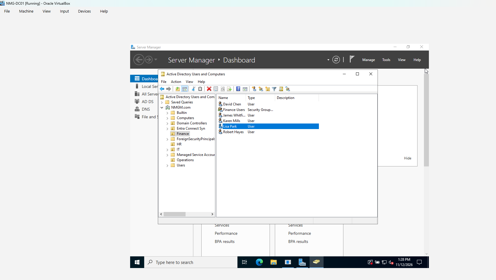

*Evidence: Lisa’s account was located in the Finance OU.*

#### 2. Verified the Account Was Enabled Before Offboarding

I used PowerShell to identify Lisa’s username and check her account status.

```powershell
Import-Module ActiveDirectory

Get-ADUser -Filter "DisplayName -eq 'Lisa Park'" |
    Select-Object Name, SamAccountName, Enabled
```

The results showed:

- **Name:** Lisa Park
- **SAM account name:** lpark
- **Enabled:** True

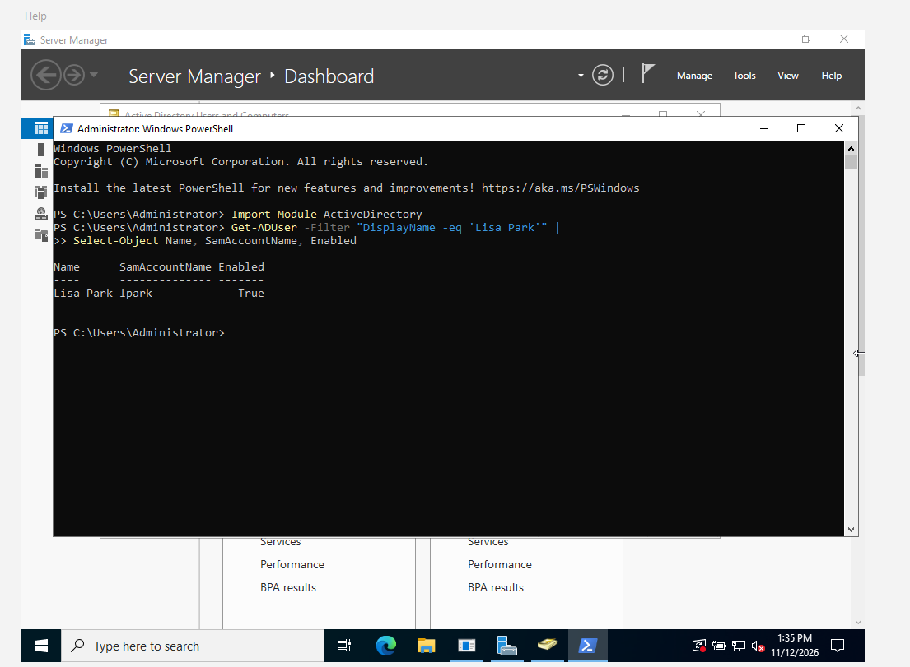

*Evidence: Lisa’s AD account was enabled before the disable action.*

#### 3. Disabled Lisa’s Active Directory Account

I disabled Lisa’s account using her verified SAM account name.

```powershell
Disable-ADAccount -Identity "lpark"
```

I then checked the account again:

```powershell
Get-ADUser -Identity "lpark" |
    Select-Object Name, SamAccountName, Enabled
```

The result changed to **Enabled: False**.

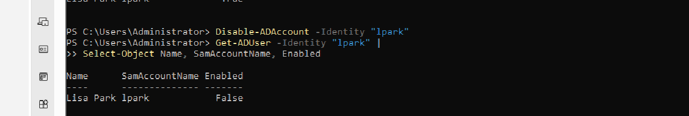

*Evidence: PowerShell confirmed that Lisa’s on-premises AD account was disabled.*


#### 4. Initiated Synchronization to Microsoft Entra ID

On the Entra Connect server, I imported the ADSync module and initiated a delta synchronization.

```powershell
Import-Module ADSync
Start-ADSyncSyncCycle -PolicyType Delta
```

The command returned **Success**.

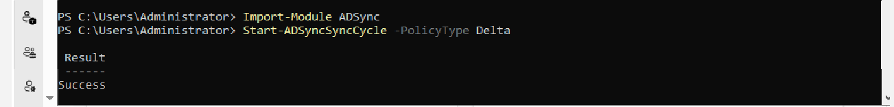

*Evidence: The synchronization request was accepted.

#### 5. Verified Lisa’s Disabled Account in Microsoft Entra ID

I opened Lisa Park’s profile in Microsoft Entra ID and reviewed her account settings and synchronization status.

- **Account enabled:** No
- **On-premises sync enabled:** Yes
- **Department:** Finance
- **Job title:** Accounts Payable

Lisa’s account remained visible because it was disabled, not deleted.

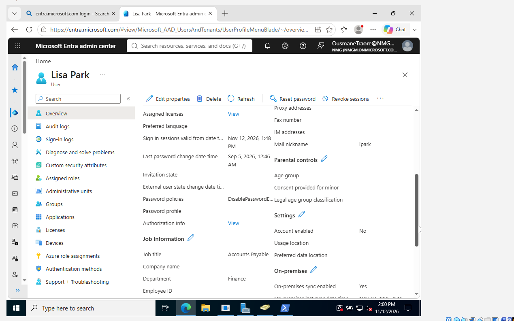

#### 6. Revoked Lisa’s Cloud Sign-In Sessions

I opened Lisa Park’s user profile in Microsoft Entra ID, selected **Revoke sessions**, and confirmed the action.

This invalidated her refresh tokens and browser session cookies. Existing access tokens or application-managed sessions may remain valid until expiration or separate termination.


#### 7. Documented the Work and Closure Notes

I documented Lisa Park’s offboarding in simulated ticket **RITM0010050**, including account disablement, Entra ID verification, cloud session revocation, access removal, and reported sign-in testing.

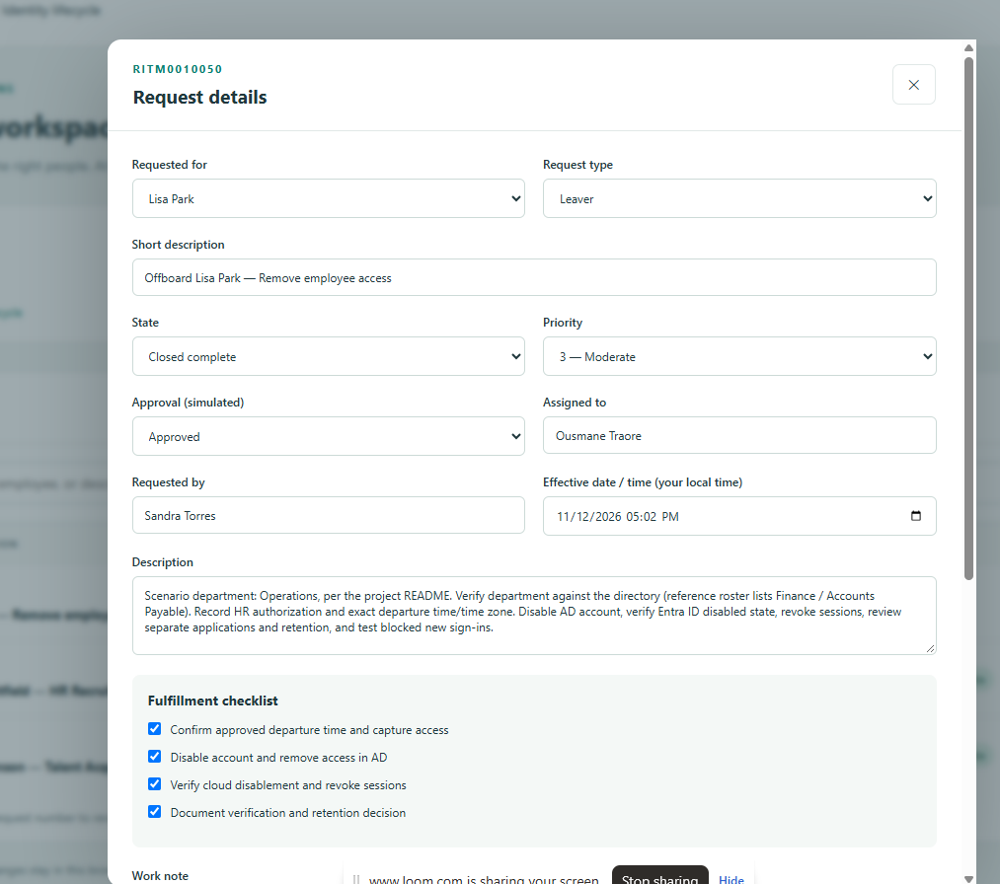

*Evidence: The simulated ticket recorded the offboarding actions and reported verification results in its work and closure notes.*


#### 8. Reviewed the Offboarding Ticket and Checklist

I reviewed simulated ticket **RITM0010050**, which recorded Lisa’s offboarding request.

- **Requested for:** Lisa Park
- **Request type:** Leaver
- **Requested by:** Sandra Torres
- **Assigned to:** Ousmane Traore
- **Approval:** Approved
- **State:** Closed complete
- **Recorded effective time:** November 12, 2026, at 5:02 PM, as displayed in the simulator’s local time

The fulfillment checklist covered account disablement, access removal, cloud verification, session revocation, and retention documentation.

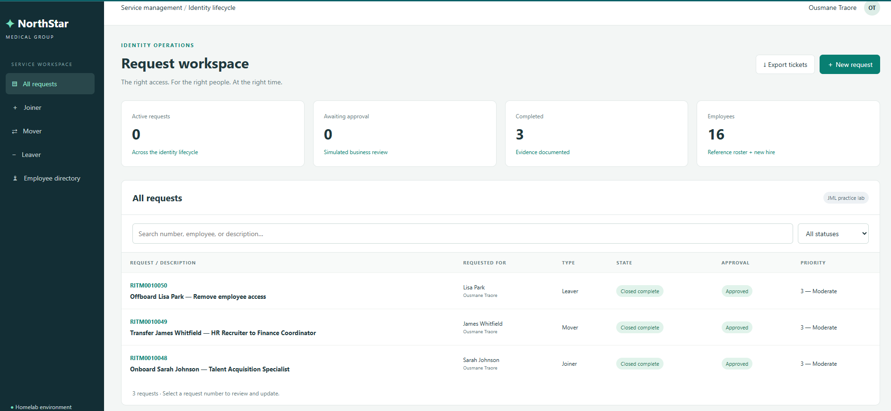


## Lab Environment

| Component | Purpose |
|---|---|
| Windows Server / Active Directory Domain Services | On-premises account and group administration |
| NMGM.COM | Active Directory domain |
| Microsoft Entra ID | Cloud identity management |
| Microsoft Entra Connect Sync | Synchronization between AD and Entra ID |
| Departmental Security Groups | Role-based access assignments |
| NorthStar Service Desk | Simulated requests, approvals, and work notes |

## Documentation and Evidence

| Location | Contents |
|---|---|
| `README.md` | Project overview, scenarios, and ticket dashboard |
| `docs/joiner.md` | Onboarding walkthrough and verification |
| `docs/mover.md` | Department-transfer walkthrough and verification |
| `docs/leaver.md` | Offboarding walkthrough and verification |
| `images/` | Project banner and lab screenshots |
| `tickets/` | Exported simulated ticket records |

Each walkthrough will document the request, actions performed,
verification results, and any troubleshooting or limitations.

Screenshots will include captions explaining what they demonstrate.
Planned actions will remain separate from completed and verified work.

## Project Progress

- [x] Define the fictional JML scenarios.
- [x] Prepare the NorthStar Service Desk simulator and scenario tickets.
- [ ] Complete and verify Sarah’s onboarding.
- [ ] Complete and verify James’s department transfer.
- [ ] Complete and verify Lisa’s offboarding.
- [ ] Add screenshots and detailed walkthroughs.
- [ ] Export completed ticket records.
 
## Learning Objectives

- Manage employee identities across AD and Entra ID.
- Apply least privilege during onboarding and role changes.
- Prevent unnecessary access from accumulating after transfers.
- Coordinate account disablement and access removal.
- Verify synchronization and distinguish it from resource-access testing.
- Maintain clear technical documentation and ticket records.

## Previous Projects

This project builds on two earlier home labs:

1. **[Basic Employee Onboarding — Active Directory and RBAC](https://github.com/otraore26/Basic-Employee-Onboarding-AD-RBAC-)**  
   Established departmental organizational units, employee accounts,
   and security groups.

2. **[NorthStar Hybrid Identity — AD to Entra ID Synchronization](https://github.com/otraore26/NorthStar-Hybrid-Identity-AD-Entra-Sync)**  
   Connected on-premises Active Directory to Microsoft Entra ID
   and verified synchronized users and groups.

## Author

**Ousmane Traore**
